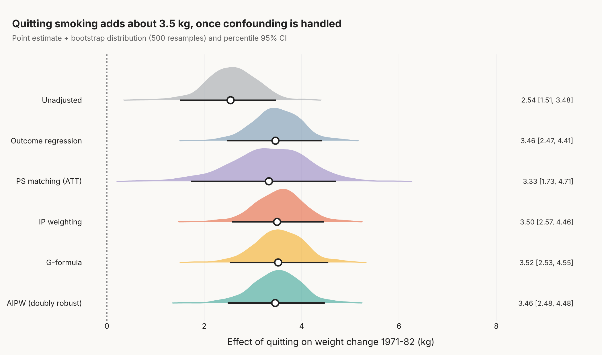
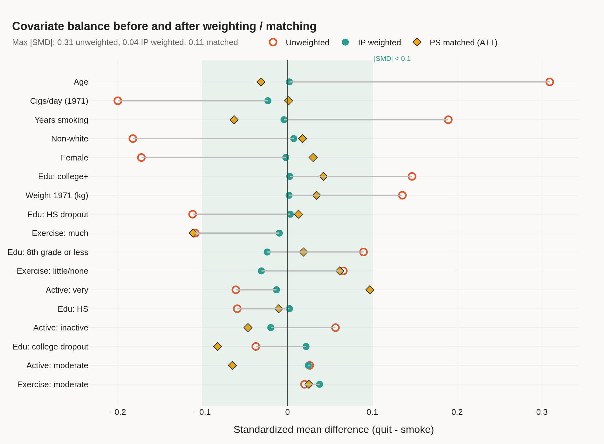
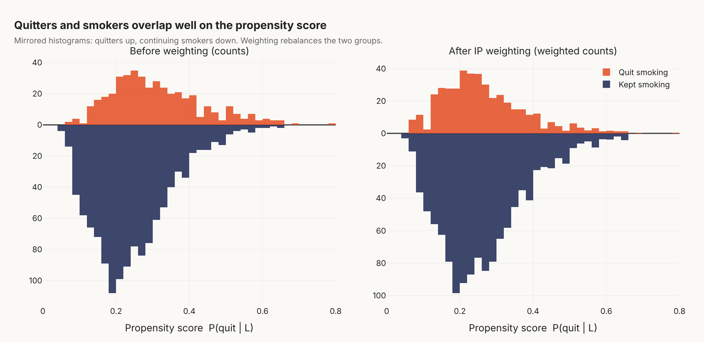
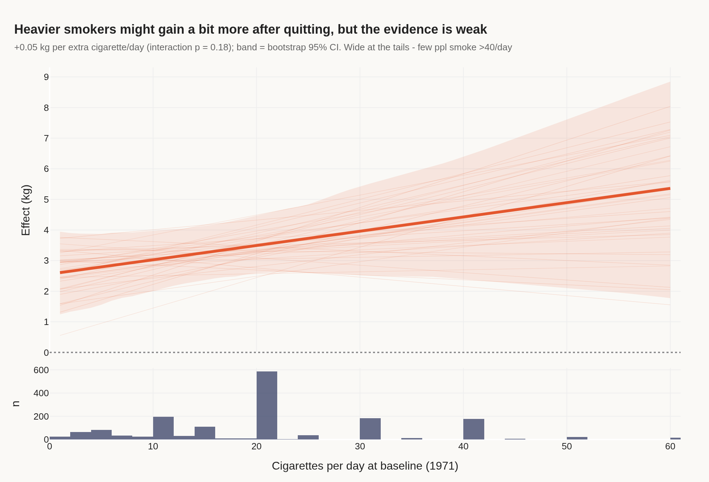

# Does quitting smoking cause weight gain? Causal inference with NHEFS (Python)

People who quit smoking gain weight, but quitters are also older, smoke less, and differ in other ways. So how much of the gain is actually *caused* by quitting?

Data: NHEFS (NHANES I Epidemiologic Follow-up Study), 1,629 cigarette smokers aged 25-74 at baseline (1971) who were followed up in 1982. This is the dataset used throughout Hernán & Robins, *Causal Inference: What If*, so I could check my numbers against the book (IP weighting chapter: ~3.4 kg).

- Treatment: `qsmk`, quit smoking between 1971 and 1982 (n = 428)
- Outcome: `wt82_71`, weight change in kg
- Confounders: sex, race, age, education, cigs/day, years smoking, exercise, activity level, baseline weight (quadratic terms for the continuous ones)

## Methods

1. Propensity score (logistic) + overlap check
2. Stabilized IP weights, plus censoring weights for the 63 people with no 1982 weight
3. Balance diagnostics: standardized mean differences before/after weighting
4. Six estimators side by side: unadjusted, outcome regression, PS matching (ATT), IP weighting (MSM), g-formula / standardization, AIPW (doubly robust)
5. Bootstrap (500 resamples) for all CIs
6. Effect modification by baseline smoking intensity
7. Sensitivity to unmeasured confounding: E-values

## Results

| Method | Target | Censoring | Effect (kg) | 95% CI | E-value (CI) |
|---|---|---|---|---|---|
| Unadjusted | crude | complete case | 2.54 | 1.51 to 3.48 | - |
| Outcome regression | ATE | complete case | 3.46 | 2.47 to 4.41 | 2.35 (1.99) |
| PS matching | ATT | complete case | 3.33 | 1.73 to 4.71 | 2.30 (1.74) |
| IP weighting | ATE | IPCW | 3.50 | 2.57 to 4.46 | 2.36 (2.03) |
| G-formula | ATE | IPCW | 3.50 | 2.51 to 4.52 | 2.36 (2.01) |
| AIPW | ATE | IPCW | 3.47 | 2.51 to 4.44 | 2.35 (2.01) |

The crude difference underestimates the effect by about 1 kg. Once confounding is adjusted for, all the methods agree on about +3.5 kg. Matching has the widest CI, as expected, since it throws away data and targets the ATT (3 of 403 quitters fall outside the 0.2 SD caliper).

E-value: an unmeasured confounder would need a risk-ratio association of about 2.4 with both quitting and weight gain (2.0 to move the CI to include 0), beyond the measured confounders, to explain the effect away. Computed with the VanderWeele & Ding approximation for a continuous outcome (RR ≈ exp(0.91 × d)).









Interactive versions (hover etc.) are the `.html` files in `figures/`.

## Run

```bash
pip install -r requirements.txt
python src/analysis.py              # ~5 min, mostly the bootstrap
python src/analysis.py --figs-only  # redo plots from saved bootstrap results
pytest -q                           # regression tests (estimates vs the book)
```

PNG export uses kaleido 1.x, which needs Chrome/Chromium installed. If it can't find one, run `plotly_get_chrome` once or set `BROWSER_PATH`, or just use the html files.

```
src/prep.py       download + clean
src/models.py     PS, weights, the 6 estimators, bootstrap, SMD
src/analysis.py   runs everything, makes figures
tests/            pytest regression tests (run in GitHub Actions)
```

## Caveats

- All of this assumes no unmeasured confounding, positivity, and correct models. Positivity looks ok (fig 1), and the max stabilized weight is ~13.
- IPW, g-formula and AIPW all use the same inverse probability of censoring weights for the 63 people with no 1982 weight. Outcome regression and matching are complete case (see the Censoring column).
- Propensity scores are truncated at 0.01/0.99 for every estimator that divides by them (observed range 0.05-0.79, so this changes nothing here).
- The smoking-intensity interaction is not significant (p = 0.18). Fig 4 is more "here's how you'd look at it" than a finding.
